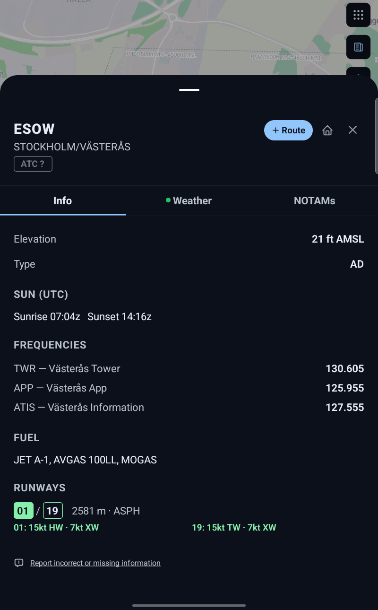
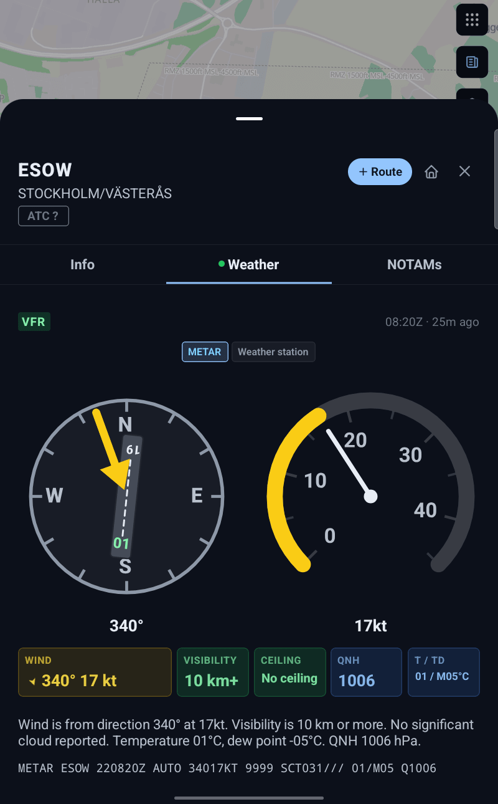
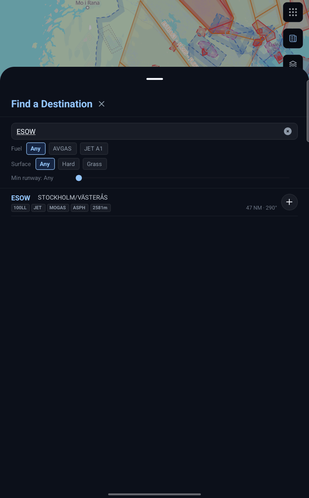
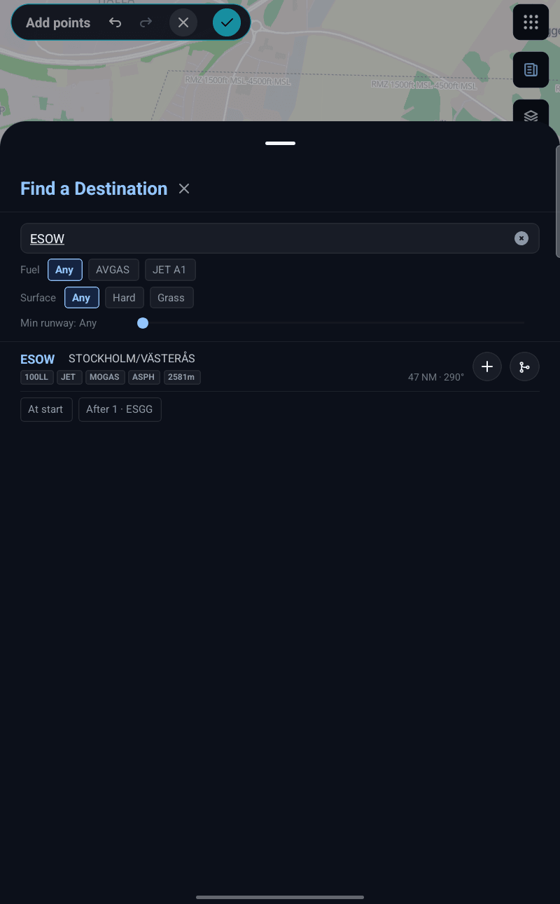

## The aerodrome card

Tap an aerodrome on the map. The card has three tabs.

**Info**
- Sunrise and sunset (UTC). Check them against your landing time.
- Frequencies.
- Runways: designators, length, width and surface.
- Hours of operation, and whether the tower is open now, worked out from
  the published schedule. A hint appears if an active NOTAM might affect
  ATC or opening hours: check the NOTAM tab. The hint comes from keywords
  in the text and is never a definitive status.
  **ATC hours?** means the aerodrome has a tower or information
  service, but its published hours could not be read as a schedule: check
  the AIP.
- Facilities (fuel and so on), **PPR and restrictions**, and contact
  details. A **PPR** badge means prior permission is required for every
  visitor. **PPR\*** means it is required only in some cases (certain traffic,
  hours or seasons): read the PPR remarks below it. No badge means nothing is
  known, not that no permission is needed: check the remarks and the
  published information.
- A button to make it your **home airfield**.

**Weather (Wx)**
- Choose a source: **METAR** (the aerodrome's own report, falling back to
  the nearest station that has one) or **Weather station** (a model-based
  current reading at the aerodrome's position). Both are always fetched and
  they are never blended: you pick which one to read.
- Decoded METAR values coloured by flight category (see
  [Weather and NOTAMs](./weather-and-notams.md)), the TAF as an
  hour-by-hour timeline, a cloud profile, and wind gauges: a compass with a
  runway drawn across it, and a speed dial.
- Pick a runway to see the headwind and crosswind components. The longest
  runway is shown by default.

**NOTAM**
- NOTAMs for the aerodrome, then the wider regional list (areas, navaid
  outages and notices that are not tied to one aerodrome).
- See [Weather and NOTAMs](./weather-and-notams.md).

## Local information

Where an aerodrome's circuit, noise rules and local procedures have been
read from its official publication or its club's own map and checked by
a person, the card has a **Local information** section and the map draws
them (from zoom 9, with more detail as you zoom in):

- **Traffic circuits**: the pattern drawn as a line with direction chevrons
  and a label such as "RWY 03 RH · RWY 21 LH" (right-hand for runway 03,
  left-hand for 21). Where only the direction is known, a short **turn
  arrow** from the runway end shows which way to turn after take-off. It
  says what the source says and never suggests a pattern size. Tap a
  runway end in the aerodrome card to show only the circuits for it.
  Circuits for gliders, ultralights and other categories are named as such.
  A drawn pattern shows its direction with chevrons even where the source
  only draws an outline: the direction comes from the left or right hand
  the source states for that runway. Where an aerodrome publishes a circuit
  for some runways only, the card's **Circuits** list says which runways
  have none stated ("Not stated for RWY 14, 04, 22. The ICAO standard is
  left-hand unless published otherwise."). No arrow is drawn for a runway
  nobody published a direction for.
  The **Circuits** list in the card is grouped by runway end, with a
  turn glyph for each hand ("RWY 12 ↶ left-hand; ↷ right-hand · gliders"),
  and states the circuit height once when it is the same everywhere. A
  turn arrow, which only gives the direction, is drawn fainter than a
  drawn circuit; circuits for gliders, ultralights, helicopters and
  gyros are drawn thinner than the one for ordinary powered aircraft, so
  the main circuit stands out where several overlap. A height whose
  source gives no reference (above the field or above sea level) says so
  in the card ("1000 ft (reference not stated)"); none is guessed. Notes
  the source gives a drawn circuit, such as "at least 150 m AGL on
  downwind", are listed under it.
- **Fly-in routes**: an arrival route a club draws on its own map (for
  example the way to join from the north) is drawn and switched like a
  circuit and labelled with its name.
- **Noise-sensitive areas** and other areas to avoid. Tap an area for its
  name, the height it applies below ("Avoid overflight below 700 ft AMSL")
  when the source gives one, and the source; the map itself shows no heights. Glider,
  parachute and model-flying areas are drawn in their own colours.
- **Reporting points** that the base map does not have, as the VFR reporting
  point triangle with their name (switch: **VFR reporting points**). They are
  one airfield's arrival points, so they show for the aerodrome whose card
  you opened last and stay until you open another aerodrome or close the app.
  **Holding points** show the direction of the orbit.
- **Local rules**, hours and PPR remarks as text, each with its source.

Anything read from a drawn chart or map is **dashed** and says how
accurate the placement is (often a few hundred metres): it shows what the
publisher draws, not a surveyed boundary. Local information is the
publisher's and the club's, not an official source: check the official
publication.

**Report incorrect or missing information** at the bottom of the aerodrome
card opens an e-mail with the airfield and the app versions filled in.

## Find a destination

Open **Find dest.** (also available from the route menu) to search
aerodromes by:

- name or ICAO code,
- fuel type: any, AVGAS or JET A1,
- surface: any, hard (asphalt and concrete) or grass (grass and sand),
- minimum runway length.

Results are sorted by distance from your position, or from the map centre
when there is no GPS fix, with the bearing and distance shown. Tap a row to
see it on the map, or press **+** to add it to the route.

On native each result also has an insert button next to **+**. It asks
where in the route to put the aerodrome: **At start**, or after any
existing waypoint.

## Direct to

While flying, **Direct to** replaces the route with a two-point route from
your position to the aerodrome you choose. Tap anywhere on a row to fly
direct to it.

- Your **home airfield** is always listed first.
- If the aircraft has glide data, aerodromes within glide range are
  highlighted in green.
- You can filter by name or ICAO code and minimum runway length.

Direct to **replaces** your route. Undo restores it.

## Charts

Where an aerodrome has official charts published, its card has a **Charts**
section. The visual approach, aerodrome, parking and ground charts are
listed first; **More charts** shows the rest, including the instrument
ones that a VFR flight does not use.

- The **arrow** icon opens the official document at the publisher. It
  works for everyone, signed in or not.
- When you are signed in, tapping a chart's **title** shows the publisher's
  own document in the app, and the **pin** icon draws a georeferenced chart
  over the map (with an opacity control).
- Charts are the publisher's own, unaltered documents. They are shown for
  the aerodromes the operator has released. An aerodrome without a Charts
  section has none released yet, so open the official publication instead.
- **Always check the official publication.** A georeferenced overlay is
  approximate (a few hundred metres) and is not for navigation.
- A deployment can restrict in-app viewing to administrators. Then the
  section is not shown to other users.

Administrators who switch on **Include unreviewed** (Settings) also see the
charts of aerodromes that are not released yet, marked as not released.

## Nearby brief

**Brief** gives one panel with three tabs for the aerodromes around you
(or the map centre):

- **Frequencies** nearby. If there is no GPS fix, it falls back to the
  aerodromes near your route.
- **Weather** and **NOTAMs** for a picker of nearby aerodromes. Aerodromes
  along your route come first, then those around your position, then your
  home airfield.

Use it in the air to get the frequency and weather of the field ahead
without hunting on the map.

## Home airfield

Set a home airfield from its card. It is used first in Direct to, as a
fallback for briefings, and has a quick button in the map tools. It syncs
with your account. See [Account and sync](./account-and-sync.md).
