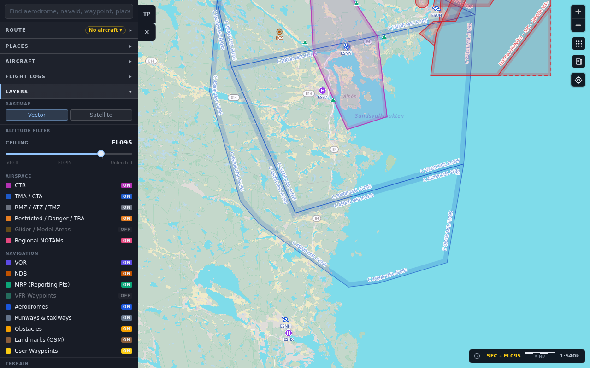
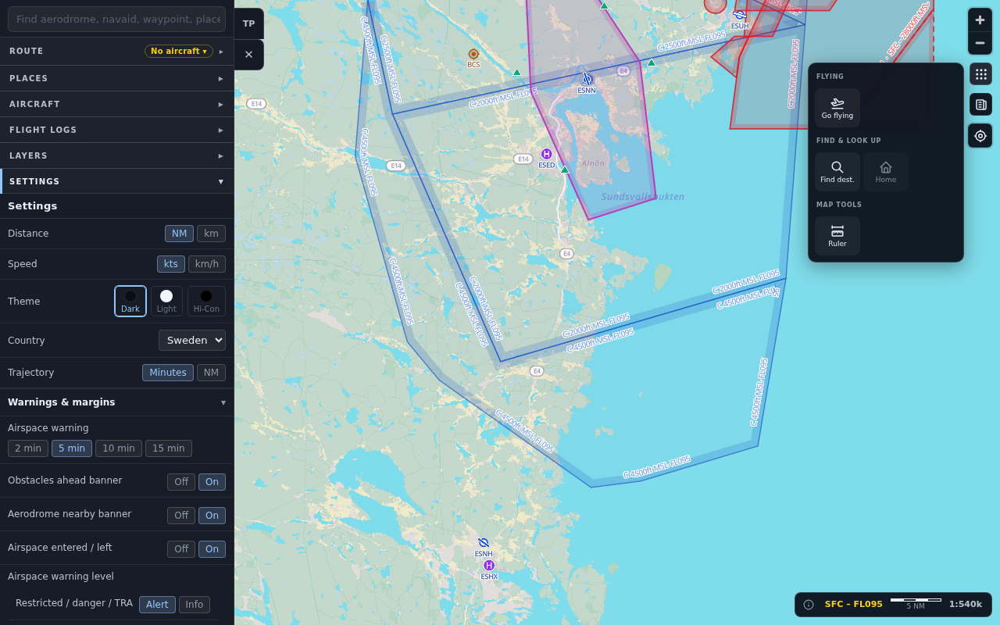

The map combines a basemap with aviation layers. Open the layer panel (the
**Layers** or **Map display** control) to change what you see.

## Basemap

- **Vector:** the standard map.
- **Satellite:** imagery for planning. It is not available while flying
  mode is on (GPS or simulator), and switches back to vector when you start.

## Layers

| Group | Layers |
|---|---|
| Airspace | CTR, TMA / CTA, RMZ / ATZ / TMZ, Restricted / Danger / TRA, Glider / Model areas, Regional NOTAMs |
| Points | VOR, NDB, MRP (reporting points), VFR waypoints, Aerodromes, Runways and taxiways, Obstacles, Landmarks, Your places (web) |
| Terrain | Land use, Hillshade (relief), Contour lines, Terrain colour |
| Live | Air traffic |
| Weather | Wind arrows |

Your choices are remembered. On native the layers are grouped in the **Map
display** sheet (sections Basemap, Airspace Ceiling, Airspace, Points,
Terrain, Weather, Live); on the web in the **Layers** panel (sections
Basemap, Altitude Filter, Airspace, Navigation, Terrain, Traffic, Weather).

When you first open the app, Glider / Model areas, Hillshade, Contour
lines, Terrain colour, Air traffic and Wind arrows are off; everything else
listed above is on. On the web, VFR waypoints are also off to begin with.

Differences on native: VOR and NDB are one **Navaids** toggle, reporting
points and VFR waypoints are one **Waypoints** toggle (on by default), and
there is no separate toggle for your places.

## Airspace

- Coloured by class, with a shaded band along the inside of the boundary so
  you can tell which side is the airspace.
- Limits are shown as published. A limit given as AGL or GND is a height
  above ground, not an altitude, so compare it with your height above
  ground, not your altitude above sea level.
- **Ceiling slider:** hides airspace that starts above the altitude you
  set (snap points include 500, 1,000, 2,000, 3,000, 5,000 ft, FL065,
  FL095, FL125, FL195 and Unlimited; default FL095). It keeps the map
  readable. When your GPS altitude climbs within 500 ft of the ceiling in
  flying mode, the ceiling is raised by 2,000 ft and you are told, so the
  airspace you are about to enter is not hidden.
- The info bar at the bottom right shows the airspace band that is
  currently shown, the scale bar, and the (i) button for map data credits.
- Tap an airspace for its name, class, type and limits.

## Terrain colour

An experimental overlay that colours the terrain by how far it is below a
reference altitude (default 2,000 ft): red under 500 ft below, orange
500 to 1,000 ft below, yellow 1,000 to 1,500 ft below, green more than
1,500 ft below. Once you are flying the reference follows your GPS
altitude. Use it as a hint, not as a clearance tool.

## What you can tap

- **Aerodromes:** the aerodrome card. See
  [Aerodromes and briefing](./aerodromes-and-briefing.md).
- **Navaids, waypoints, obstacles, landmarks, your places:** a card with
  its details and a button to add it to the route.
- **Airspace:** the limits and class.
- **Anywhere else:** on the web app the **What's here** popup lists
  everything under the point; on native a small popover offers to save the
  spot as a place, fly direct to it, or start or extend a route there.

## Search

Use search to find aerodromes, navaids, reporting points, waypoints,
landmarks and your places by name or code. You can also type a coordinate
(in common formats), or a bearing and distance from a point, and jump
there.

## Map tools

The tools menu groups:

- **Flying:** go flying or stop, auto zoom, direct to, pilot log.
- **Find and look up:** find a destination, home airfield.
- **Map tools:** ruler, drop point.
- **Go to** (native): flight plan and settings.
- **Brief:** one tap away on the map. See
  [Aerodromes and briefing](./aerodromes-and-briefing.md).

The **ruler** measures distance and bearing between two points you tap.
Tap the tool again to clear it.

## Orientation

The compass button shows where north is. In flying mode, tapping it cycles
**North up**, **Track up**, and **Course up** (when the route has a leg).
Off flying mode, it re-aligns a rotated map to north.

## Share a link

A link can open the app on an aerodrome (`?ad=ESSB`) or at a position
(`?c=5939N01756E&z=11`). Malformed parts of a link are ignored.
